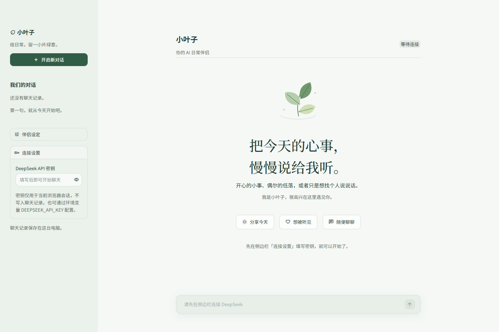

# 小叶子 · AI伴侣

一个使用 Streamlit 和 DeepSeek 构建的日常陪伴聊天应用。雾绿界面、叶片插画，让聊天留一点轻松的空间。

它用于在本机调整伴侣设定、进行简短聊天，并在后续继续自己的会话。



## 功能

- 流式显示 AI 回复，支持自定义伴侣昵称和性格。
- 本地保存聊天记录，可切换、新建和删除会话。
- 提供三个开场话题，点击后填入输入框，由你确认发送。
- 回复失败时保留用户消息，可以重新请求回复。
- 手机端自动收起侧边栏，适配窄屏阅读。

## 本地运行

以下为 Windows 安装方式。当前验收环境及检查范围见 [验证记录](.verification/app-review.md)。

```powershell
git clone git@github.com:liyu111474/ai-companion.git
cd ai-companion
python -m venv .venv
.\.venv\Scripts\python.exe -m pip install -r requirements.txt
.\.venv\Scripts\python.exe -m streamlit run app.py
```

也可以在 GitHub 点击 **Code → Download ZIP**，完整解压项目后，在项目目录执行创建虚拟环境、安装依赖和启动命令。安装依赖后，可以双击 `启动小叶子.cmd`；它优先使用项目 `.venv`，没有 `.venv` 时使用 PATH 中的 Python。

**请保留整个项目结构。** `app.py` 会读取旁边的 `style.css` 和 `static/leaf.svg`，只复制 Python 代码会因缺少资源而无法启动。从项目目录启动，才能加载 `.streamlit/config.toml` 中的主题配置。

## 连接 DeepSeek

打开侧边栏「连接设置」，填写自己的 DeepSeek API 密钥即可聊天。输入框中的密钥只用于当前浏览器会话，不写入聊天记录。

也支持在启动前设置环境变量：

```powershell
$env:DEEPSEEK_API_KEY = "你的 DeepSeek API 密钥"
.\.venv\Scripts\python.exe -m streamlit run app.py
```

或者使用 `.streamlit/secrets.toml` 中的 `DEEPSEEK_API_KEY` 配置。真实密钥、环境文件和聊天记录已列入 `.gitignore`，应保留在本机。

模型使用 `deepseek-flash`，接入方式见 [DeepSeek 官方文档](https://api-docs.deepseek.com/guides/codex)。

## 项目结构

```text
ai-companion/
├── app.py                 # 页面、会话管理和 AI 回复
├── style.css              # 布局和轻柔阴影
├── requirements.txt       # 依赖版本
├── LICENSE                # MIT 许可证
├── PUBLIC_FILES.md        # 公开文件范围
├── 启动小叶子.cmd           # Windows 启动入口
├── .streamlit/config.toml  # 颜色、字体和圆角
├── static/leaf.svg        # 欢迎页插画
├── .verification/         # 五份已审阅的验收材料
├── docs/                  # 开发、发布流程及版本说明
└── tests/                 # 行为与安装回归测试
```

聊天记录在运行后写入 `sessions/`，该目录不会上传到 GitHub。旧记录只要包含 `messages`、`nick_name` 和 `nature` 字段，就可以复制到该目录继续使用。

## 使用方法与输入输出

1. 在「连接设置」填写密钥；昵称和性格可在「伴侣设定」中修改并保存。
2. 输入消息或点击开场话题，再确认发送。
3. 在「我们的对话」里恢复历史；消息发送失败时可点击「重新回复」。

例如，输入 `今天有点累`，自动测试替身会依次返回 `愿意听你说。` 和 `慢慢来。`，页面合并显示为：

> 愿意听你说。慢慢来。

这是用于验证流式呈现的示例，不是实际模型请求的验收结果；真实回复由服务和角色设定决定。

保存的记录包含 `nick_name`、`nature`、`messages` 和 `current_session`。每条用户消息先尝试保存到运行应用的这台电脑，再请求回复；保存失败会提示，当前内容仍保留在页面中。保存伴侣设定也会生成可恢复的记录，空白新对话本身不会生成历史文件。

## 界面

背景采用雾绿白 `#F5F8F5`，强调色为松针绿 `#315C46`。正文优先使用 Noto Sans SC，欢迎标题优先使用 Noto Serif SC；未安装时使用系统回退字体。

[查看手机预览](.verification/mobile-full.png) · [查看项目副本启动预览](.verification/installation-full.png)

## 测试

```powershell
.\.venv\Scripts\python.exe -m unittest discover -s tests -v
```

行为测试覆盖会话切换、新建与删除、角色设定、损坏记录、回复失败重试、流式中断和磁盘保存失败。安装测试覆盖完整项目副本以及 Windows 启动器的项目虚拟环境、工作目录和参数。测试使用临时目录和 API 测试替身，不读取真实记录、不调用付费模型。

检查结果见 [应用审阅记录](.verification/app-review.md) 和 [浏览器检查记录](.verification/viewer-checks-full.json)。验证声明以记录为准；项目副本启动通过不等同于已在全新机器上安装全部依赖。真实服务连通性需要有效的 DeepSeek 密钥。

## 开发与发布

开发步骤见 [开发验收](docs/DEVELOPMENT.md)，公开文件范围见 [PUBLIC_FILES.md](PUBLIC_FILES.md)，提交、推送及 Release 操作见 [发布流程](docs/RELEASING.md)。

修改代码后先验证、核对文档与公开范围，再确认要提交和发布的内容。本地修改或复制到另一目录不代表 GitHub 已更新。版本说明稿见 [v0.1.0](docs/RELEASE_NOTES_v0.1.0.md)，该文件本身不代表标签或 Release 已创建。

## 许可证

项目采用 [MIT License](LICENSE)。依赖及可选字体的许可来源见 [第三方说明](THIRD_PARTY_NOTICES.md)。
